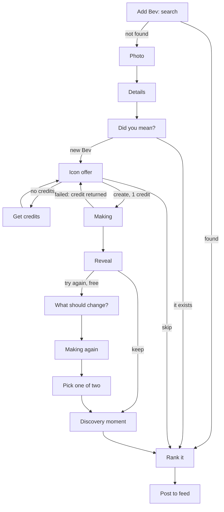

# Bevi — Icon Pipeline Vision

> You did not just rate a drink. You put it on Bevi, and you made its icon.

| | |
|---|---|
| **Ticket** | [BEV-15](https://linear.app/bevi-ticketing/issue/BEV-15/custom-bev-icon-creation-user-made-icons-icon-credits-and-discovery) (umbrella) |
| **Lead** | Arjun leads development: the generation pipeline, the backend, the credits |
| **App and design** | Matt: the screens, the design system, sign-off on icon style |
| **Source** | Matt and Arjun's working session at Princeton, 2026-11-14 (transcript in Appendix A), plus Matt's product direction given the same day |
| **Status** | Vision and proposal. Nothing here is built. The UI/UX flow has **not** been agreed yet (section 7) |

**How to read this file.** Every statement carries one of three labels, in the heading or in the line:

- **Decided**: said and agreed in the 2026-11-14 session, or stated by Matt as product direction.
- **Proposed**: a concrete suggestion written up for the two of you to react to. Not agreed.
- **Open**: a question nobody has answered. All of them are collected in section 17.

When a proposal is accepted or an open question is answered, change its label here and note the date. This file is the record; the ticket links the work.

**Current implementation direction (2026-11-16).** For the first pipeline pass,
a photo-backed user-created Bev automatically enters icon generation when it is
created. There is no request button, credit gate, or charge in this flow. The
worker can be held off operationally until the icon style and quality bar are
agreed. Badges, regeneration, candidate selection, and monetization remain
future product decisions; the credit-based exploration below is historical,
not the current implementation requirement.

---

## 1. The idea

Bevi's catalog has icons for the drinks everybody knows: Coca-Cola, Fresca, Red Bull. They are drawn by hand, one product at a time. That cannot reach the drinks that make a feed interesting: the espresso martini from one cocktail lounge, the chai from Small World Coffee, the smoothie you made this morning.

So the user makes the icon. When someone adds a drink that is not in the catalog, Bevi offers to create its icon from their photo and the details they typed. The result is drawn in the same style as every other Bevi icon. It costs one icon credit. From then on, that icon is that drink on Bevi, for everyone, and the person who created it is credited as its discoverer.

Three things happen in one action: a new Bev exists, it has an icon that belongs in the collection, and somebody's profile says they found it.

## 2. Why it is a core feature

- **It is what makes posting on Bevi different.** (Decided.) Other rating apps let you score what is already listed. On Bevi you add the drink and make its icon.
- **It closes a gap we already hit.** On 2026-10-14 we decided that icons, not photos, are a Bev's identity in search, posts and lists, because "you're collecting something". On 2026-10-19 that work was put on hold, because generated icons could not cover craft cocktails and one shop's own drinks. The catalog icons came back as hand-drawn work for the 378 seeded drinks. User-created icons are how every other drink gets one.
- **It is the biggest gamification step so far.** (Decided.) Creating, discovering and collecting, visible on the profile.
- **It is one of Bevi's monetization areas.** (Decided.) Each generation costs us a model call. Credits turn that into a paid consumable. See sections 10 and 18.

## 3. Where we are today

Checked against `origin/main` on 2026-11-14 (contract 2.13.0).

**Catalog icons.** 275 icons exist and 103 catalog drinks remain. Each is an SVG built from shared drawing primitives (`scripts/icons/style.mjs`) and a per-product recipe (`scripts/icons/families/*.mjs`), on a transparent 200 × 260 canvas. The style rules are in `design/beverage-icons/skill/SKILL.md`: a centred upright drink, a slightly top-down view, soft gradients, restrained highlights, one ground shadow, real proportions and colours. An agent researches each product against real reference images, and Matt approves each batch by eye.

**How an icon reaches the app.** The manifest in git is the source of truth. A publish job uploads the SVGs to the public `bev-icons` bucket and writes `public.bev_icons`. The API returns `BevSummary.iconUrl`. The app draws a Bev's image as photo first, then icon, then category art.

**Adding a new Bev.** The create-Bev wizard has three steps: photo, details (name, brand or shop, flavour, category, price, optional nutrition label), then "Did you mean…?" for likely duplicates. Then the Bev is created and the user goes straight into ranking it. A photo is required.

**What does not exist.** Any generation of icons at run time, any credit or balance, any payment code, any badge, any notion of a homemade drink.

**Four facts about today's code that shape this feature** (details in section 14):

1. The catalog publish job replaces the whole icon table. A user-created icon stored there would be deleted at the next publish.
2. A photo always wins over an icon, and every user-created Bev has a photo. Today a created icon would never be shown.
3. The icon bucket takes SVG only and nobody but the service role can write to it, because an SVG can carry script.
4. `Bev.createdBy` already records who added a Bev. "Discovered by" can be built on it.

## 4. What was decided on 2026-11-14

| # | Decision | Notes |
|---|---|---|
| 1 | Icon creation is offered for **non-generic** drinks | Common drinks keep their catalog icons |
| 2 | It is **optional** | "They have the optionality to create an icon" |
| 3 | Every result is **strictly in the Bevi icon style** | A regeneration stays inside the style too |
| 4 | Users start with **3 to 5 free credits** and can **buy more** | Exact number open. Example price discussed: $4.99 for 10 |
| 5 | **One credit creates one icon** | "To generate an icon in the first place, you use one of your credits" |
| 6 | After the first result the user can **regenerate for free**, then **pick** | "Then you can pick which one of them you want" |
| 7 | **Optional design notes** before the first generation | "If they care" |
| 8 | Design notes are **always offered on a regeneration** | That is when the user is saying "this does not look like what I wanted" |
| 9 | On a regeneration the user can **add another photo** | Cannot be required: Arjun had already thrown the chai away |
| 10 | **No chat feature** | "I don't want them typing more" |
| 11 | The Bev's name and shop are **already context** for the model | The user typed them in the create flow |
| 12 | The feature needs a **catchy, marketable name** | Not chosen. Section 13 |
| 13 | Arjun owns the icon pipeline | |

Stated by Matt as direction, the same day:

| # | Direction |
|---|---|
| 14 | The experience must be **extremely fun**. The user should feel they are creating something new and get a real hit of delight |
| 15 | It should have a **discovery** feel, and could show as **badges on the profile** |
| 16 | **Drinks the user makes** (a smoothie, latte or cocktail made at home) can be posted to Bevi |
| 17 | This is one of the **core** features of the platform and one of its **monetization** areas |
| 18 | The **whole UI/UX flow** must be walked through and agreed before it is built |

The principle behind 6 to 9, in Matt's words: the user has just spent a credit, so "we have the obligation to give them the optionality to make it up to whatever they envision in their head."

## 5. Experience principles

These follow from the decisions above. Use them to judge any screen.

1. **The reveal is the product.** The few seconds between tapping "create" and seeing the icon are the reason this feature exists. Design that moment first.
2. **One tap is enough.** A good photo and the details already typed should produce a good icon with no extra input. Notes and extra photos improve it; they are never required.
3. **Style is not negotiable.** The user steers what is drawn (the cup, the colours, the topping, the lettering). They never steer how it is drawn. A created icon has to sit next to a catalog icon without looking foreign.
4. **A credit is a promise.** If Bevi fails, the user does not pay. If the user spends a credit, they leave with an icon they chose.
5. **Creating is discovering.** The icon is tied to a person. Their name stays on the Bev.
6. **It is a collection.** Icons are what make the Bev'd list, the profile and the feed look like something you are building.
7. **Fast to start, fine to leave.** The user is standing in a café with a drink in hand. They can start in seconds, and nothing is lost if they close the app while the icon is being made.

## 6. Which Bevs get a user-created icon

| Kind of Bev | Example | Icon source | Label |
|---|---|---|---|
| Catalog drink | Coca-Cola, Fresca, Red Bull | Hand-drawn catalog icon. No user creation | Decided |
| Catalog drink whose icon is not drawn yet | One of the 103 remaining | Category art until its batch ships. No user creation | Proposed |
| New drink from a place | Small World Coffee chai latte; one lounge's espresso martini | User-created icon | Decided |
| New packaged drink not in the catalog | A small-batch soda from a local maker | User-created icon | Proposed |
| Homemade drink | A smoothie, latte or cocktail the user made | User-created icon. Section 12 | Decided as direction; details open |
| Existing user-added Bev with no icon | A Bev added before this feature shipped | Its creator can add an icon later; others cannot | Proposed (open question 5) |

The line between "generic" and "non-generic" needs a rule the app can apply. Proposed: a Bev is eligible when a user is creating it, which already means the search and the duplicate check did not find it. Nothing in the catalog is eligible.

## 7. The user flow, screen by screen

**Status: Proposed. This is the draft for the UI/UX walkthrough, not an agreed design.** It is written so the two of you can go through it screen by screen and change it. The names of screens and components are placeholders. Copy is plain on purpose; the real words depend on the name chosen in section 13.

Everything here goes through the design system first, then the app screen, as every other screen has.

### 7.1 The flow at a glance

### 7.2 Where the user starts

1. **Add Bev tab → search → "Add a new Bev".** The main path. The icon step is a new fourth step in the existing wizard.
2. **A Bev page with no icon, opened by the person who added it.** A "Create its icon" action. This covers "skip for now" and Bevs added before the feature.
3. **The profile.** The credits balance and the collection of created icons, with a way in to create the next one.

Open: whether there is a separate, louder entry for homemade drinks ("Made it myself") or only a choice inside the wizard. Section 12.

### 7.3 Steps 1 to 3: photo, details, duplicates

These exist today. Two changes are proposed:

- **Photo step.** Add the capture guidance from section 8, and allow up to three photos of the drink, not one. The first is the Bev's photo; the others are extra angles for the icon.
- **Duplicates step.** No change to the screen, but it becomes a hard rule that it runs **before** any credit can be spent. Nobody should pay to create an icon for a drink that already has one.

### 7.4 Step 4: the icon offer

What the user sees:

- Their photo, and next to it an empty icon tile in the Bevi style with the Bev's name under it. The empty tile is the invitation.
- One line saying what this is: this drink is new to Bevi, and they can make its icon.
- A primary button: create the icon. It shows the cost and the balance in the button or beside it, for example "1 credit · 3 left". The cost is never hidden behind a second screen.
- A quiet secondary action: skip for now. The Bev is created with its photo and the user goes to ranking. They can create the icon later from the Bev page.
- A collapsed, optional line: "Anything we should know?" One sentence, a short limit (proposed 140 characters), with an example hint such as "white cup, the shop's name on the side". Closed by default, because of decision 10.

Things to decide in the walkthrough: whether the Bev is created before or after this step (it affects "skip", "leave and come back" and what the duplicate check protects); the exact wording of the cost; whether first-time users see a one-screen explanation of credits.

### 7.5 Making

The wait. How long it takes is unknown until the spike (section 14); assume anywhere from a few seconds to half a minute.

- The empty tile fills in. Proposed direction: the drink is "poured" or drawn into the tile, in the app's existing motion language, with a still version under Reduce Motion.
- A short line of copy that changes once or twice. No progress percentage that we cannot honour.
- The work runs on the server. If the user closes the app or loses signal, the icon is still made and is waiting when they return.

Things to decide: whether the user must wait here, or can go on to rank the drink and have the icon arrive during or after ranking. Waiting keeps the reveal as one clean moment. Moving on respects their time. Proposed: wait here up to a set limit, then offer "keep going, we'll show you when it's ready".

### 7.6 The reveal

- The icon arrives large, alone, on a clean surface. This is the moment for sound-free celebration: motion, and a haptic tap where the platform allows it.
- Below it, the same icon as it will really appear: in a list row and on a feed post, at real sizes. People judge an icon differently at 40 px than at full size, and the small size is where it will mostly live.
- A primary button: keep it.
- A secondary button: try again, marked as free.

### 7.7 Try again: what should change?

A sheet, not a new screen and not a chat.

- "What should change?" with one optional sentence.
- Tappable shortcuts above the text field, so most people never type: wrong cup or glass, wrong colour, missing topping, wrong lettering, too plain. Tapping one fills in the note.
- "Add another photo", from the camera or the library. Optional.
- A button to make the second version.

The first result is kept. The second generation then runs through the same making screen.

### 7.8 Pick one of two

- The two icons side by side, at the same size, with the same small-size previews.
- Tap one, confirm. The other is discarded.
- If further tries are allowed at the cost of another credit (open question 2), the offer goes here, clearly priced.

### 7.9 The discovery moment

Shown once, right after the user keeps an icon.

- The icon, the Bev's name, and a line that the user discovered it.
- Their progress: which discovery this is for them, and how far the next badge is (section 11).
- One button: rank it. This goes into the existing ranking flow, unchanged.

### 7.10 Ranking and the post

The ranking flow does not change. The post that results is marked as a new Bev: the icon is shown with the post, and the user's own photo is the post's picture. Friends see who found the drink.

### 7.11 Where the icon and the discovery live afterwards

| Surface | What changes | Label |
|---|---|---|
| Lists, search results, leaderboard, map callouts | The row shows the created icon | Proposed (needs the image-order change, section 14) |
| Bev page | The icon is the hero. "Discovered by @handle". Photos from people's posts sit below | Proposed |
| Feed | A new-Bev post carries the icon and the discoverer | Proposed |
| Profile | A count of discoveries, a shelf of the icons the user created, and badges | Proposed |
| Settings or profile | The credits balance, its history, and "get more" | Proposed |

### 7.12 The other paths

Each of these needs a designed screen or state. None should be left to an error toast.

| Situation | Proposed behaviour |
|---|---|
| No credits left | The offer screen still shows the empty tile. The button becomes "get more credits". Skip stays available. Until buying ships (section 16), it explains how credits are earned or when more arrive |
| Generation fails on our side | The credit comes back automatically. The user is told plainly and can try again or skip |
| Photo or note breaks the rules | Nothing is generated, no credit is spent, the user is told which input to change |
| The result is unusable (blank, off-style, wrong object) | A server check catches what it can before the reveal and retries once without telling the user. If the user still gets a bad result, the free try covers it |
| The user closes the app while it is being made | The job finishes. On return, the app shows the reveal |
| The user closes the app at the reveal or the pick | The first result is kept as the icon after a set time, so a spent credit always produces an icon |
| The drink turns out to be a duplicate later | The Bevs are merged by an admin, as today. The surviving Bev keeps one icon. Who keeps the discoverer credit is open question 9 |
| A cocktail, beer or wine | The whole flow sits behind the 21+ gate, as these Bevs already do |
| The user dislikes the icon days later | Open question 6: redo for a credit, or never |
| Someone else thinks the icon is wrong | Open question 5. Proposed: they can report it, as they can report a Bev today; they cannot replace it |
| Slow or no connection | The photo upload already retries. The offer explains that creating an icon needs a connection, and skip still works |

### 7.13 What the walkthrough has to produce

The session is done when each of these has an answer written back into this section:

1. The order of steps, and whether the Bev exists before or after the icon step.
2. The offer screen: copy, how cost is shown, what skip does.
3. Capture guidance: what the photo step tells the user (section 8).
4. The making screen: the motion, the copy, wait or move on.
5. The reveal, the try-again sheet and the pick screen.
6. Out-of-credits and buying, including what is shown before buying exists.
7. Failure and rejection states.
8. The discovery moment, and the profile, Bev page and feed changes.
9. The homemade flow (section 12).
10. A list of new or changed design-system components.

## 8. Getting a good photo: the Small World problem

The case that started this. Arjun photographed a Small World Coffee chai from directly above. The picture shows foam. It does not show the side of the cup, which is marbled with coffee. It does not show how tall the drink is. It does not show the shop's name printed on the cup. An icon made from that photo alone would be a guess.

This is the most important input-quality problem in the feature, and it is cheaper to prevent than to fix by regenerating.

**What the model receives** (Decided for name and shop; the rest Proposed):

- The Bev's name, the brand or shop, the flavour and the category, all typed in the details step.
- The photo or photos.
- The optional one-sentence note.
- For a regeneration: the first result, the note on what should change, and any new photo.

**Proposed ways to get better input, cheapest first:**

1. **Say what makes a good photo, on the photo step.** One line and a small example picture: from the side, the whole cup or glass in frame.
2. **Allow more than one photo** at the start, not only on a regeneration. A side shot and a top shot together answer most questions.
3. **Notice a weak photo before spending the credit.** If the photo looks top-down or cropped, say so on the offer screen and suggest another angle, with "create anyway" still available. This check has a cost and is optional for a first version.
4. **Ask one closed question when it matters.** For example, when no vessel is visible: "What was it served in?" with four pictures to tap. This is tapping, not typing, so it fits decision 10.

**Lettering.** The shop's name on a cup is exactly what the user expects to see and exactly what image generation tends to get wrong. Whichever approach the spike picks, text on the icon should come from what the user typed, set in a controlled way, and not from the model's reading of the photo. The catalog style already simplifies small text.

## 9. Regeneration

**Decided.** The first generation costs one credit. The user can then regenerate for free and pick which result to keep. A regeneration stays inside the Bevi style. Notes are always offered. A new photo is offered but never required.

Arjun's objection in the session is worth keeping in view: a regeneration with no new information is a gamble on whether the result is better, and nobody wants to pay for a gamble. Two things answer it. The regeneration is free, and the user keeps the first result and chooses between the two, so trying again can never make things worse.

**Open.**

- How many free regenerations one credit includes. The session's wording reads as one. Proposed: one, giving two results to choose from.
- Whether further tries cost a credit each, or are not offered.
- Whether a note or a new photo is required to regenerate. Proposed: not required, but the sheet makes them the easy path, since a retry with new information is far more likely to help.

## 10. Icon credits and monetization

### What was decided

- A new user has 3 to 5 free credits.
- Credits can be bought. The example discussed was $4.99 for 10.
- One credit creates one icon, with a free regeneration included.
- The reason to charge at all: each generation is a paid model call. The cost to us is small, and the feature is valuable to the user.

### How credits should behave (Proposed)

- **Spent on the server, never by the app.** The balance is a ledger of grants, purchases, spends and refunds. The app reads it and cannot change it.
- **Returned automatically** when a generation fails or is blocked through no fault of the user.
- **Always visible before it is spent.** The offer shows the cost and the balance.
- **Never expire**, if they were bought.
- **Can also be earned**, so that people who never pay still feel the loop: for example a credit for a ranking streak, for an invited friend who joins, or when enough people rank a Bev you discovered. Which of these, if any, is open question 12.

### Rough economics

At $4.99 for 10, a credit sells for about $0.50. A card payment on that size of purchase costs a fixed fee plus a percentage; at the common rate of 2.9% plus $0.30 that is about $0.44 of the $4.99, leaving roughly $0.45 per credit. Check the provider's current pricing before relying on this. One credit covers up to two generations plus any checks we run on the input and the output. So the full cost of one generation needs to sit well under about $0.20 for the pack to carry a healthy margin, and the free starting credits are a pure cost per new user.

We do not know the real cost per generation. The spike measures it, and every generation in production should record what it cost.

Small packs lose a large share to the fixed fee. That argues for a larger default pack, or for more than one pack size. Open question 11.

### How buying would work

Bevi is a web app added to the home screen. It is not in an app store. So credits would be bought through a web checkout, and no payment code exists in the repository today. If Bevi later ships as a native app, the app stores' rules for digital purchases apply and must be checked at that point.

Bevi today is an invite-only group of friends. Proposed: the first version ships credits with free grants only and no checkout. That lets us see how many credits people actually use, and what a generation actually costs, before any price is set. Buying is its own later phase (section 16).

### The subscription

The plan already includes a paid tier. Whether it includes a monthly allowance of credits, and how that sits beside packs, is open question 13.

## 11. Discovery and gamification

**Decided as direction:** this should feel like discovery, and it could show as badges on the profile. Everything below is **Proposed**.

### The discoverer

The first person to add a Bev is its discoverer. Their handle appears on the Bev's page for everyone. The data is already there: every Bev records who created it.

### On the profile

- **A discoveries count**, next to the existing counts.
- **A shelf of the icons the user created**: a grid, newest first. This is the collection made visible, and the reason to make the next one.
- **Badges.**

### Badge ideas

| Badge | Earned when |
|---|---|
| First discovery | The user's first new Bev with an icon |
| Milestones | 5, 10, 25, 50 discoveries |
| Category firsts | The first discovery in a category: first coffee, first cocktail, first smoothie |
| Local | Several discoveries from venues in the same neighbourhood |
| Trendsetter | A Bev the user discovered has been ranked by 10 other people |
| Top shelf | A Bev the user discovered reaches a category leaderboard |
| Made it myself | The first homemade Bev (section 12) |

The badges that depend on other people ranking your discovery matter most. They reward adding a drink that others go and try, which is what the product wants, and they cannot be farmed alone.

### In the feed

A new-Bev post looks different from an ordinary ranking: the icon is prominent and the post says who found the drink. Friends can save it to Want to Try as they can today.

### Keeping it honest

Rewards for creating things invite junk. Guardrails:

- The duplicate check runs before creation, and credits make each creation cost something.
- Discoveries that are merged into another Bev or hidden by an admin stop counting.
- The badges worth showing off require other people to rank the Bev.
- A limit on creations per day, alongside the rate limits that already exist for user-created content.

### Rank on Bevi

Whether discoveries add to a user's rank points is open question 10. If they do, the formula lives in `packages/ranking` and nowhere else.

## 12. Homemade Bevs

**Decided as direction:** a user can post a drink they made themselves, such as a smoothie, a latte or a cocktail, and it gets its own icon. The details below are **Proposed** or **Open**.

A homemade Bev stretches one of Bevi's founding rules. Today "a specific horchata from a specific spot is its own Bev". A homemade drink is a Bev whose spot is one person's kitchen. Most people on Bevi can never try it. That changes several things.

| Question | Proposed answer |
|---|---|
| Who is the maker? | The user. The Bev shows "Made by @handle" where a brand or shop would be |
| Does it have a venue? | No |
| Does the duplicate check run? | Only against the same user's own homemade Bevs. Two people's banana smoothies are two different Bevs |
| Can others rank it? | Yes, if they have had it. The maker's friends are the ones who will. Bevi already trusts people to rank only what they drank |
| Is it on the global leaderboard? | No, by default. A drink three people can try should not sit beside Coca-Cola. A separate homemade board is possible later |
| Can it be saved to Want to Try? | Open. It is a nice signal to the maker; it is also a list item the saver cannot go and buy |
| Recipe or ingredients? | Not in the first version. It is the obvious next step, and it would also improve the icon |
| Which categories? | The existing ones. A homemade cocktail is behind the 21+ gate like any other |
| Does it count as a discovery? | It counts as a creation, with its own badge. Whether it counts toward discovery milestones is open |

The icon flow is the same as section 7. Homemade drinks are probably where it is most fun, because the drink is the user's own work twice over.

This is the least defined part of the feature. It is proposed as its own phase, after the main flow works.

## 13. Naming

**Decided:** the feature needs a name that is catchy and marketable. **Open:** which name.

The name has to cover three things: the act ("___ a Bev"), the credit ("3 ___ left"), and ideally the badge for being first. One word that does all three is worth more than three good words.

| Candidate | The act | The credit | Notes |
|---|---|---|---|
| **Pour** | "Pour a new Bev" | "3 Pours left" | A drink word, short, works as noun and verb. "First Pour" is a ready-made name for the discoverer badge |
| **Mint** | "Mint a Bev" | "3 Mints left" | Says "make a collectible", and mint is also a flavour. Carries crypto associations some people dislike |
| **Brew** | "Brew an icon" | "3 Brews left" | Warm and familiar. Leans toward coffee and beer |
| **Craft** | "Craft a Bev" | "3 Crafts left" | Fits craft drinks. Weak as a credit name |
| **Bev Studio** | "Open the Studio" | "Studio credits" | Names a place, not an act. Sounds like a tool more than a game |
| **Sip** | "Sip it in" | "3 Sips left" | Light and friendly. Weak as a verb for creating |

Recommendation: **Pour**, because it is the only candidate that gives a natural act, a natural credit and a strong badge name from one word. This is a recommendation, not a decision. The rest of this file uses plain words ("create an icon", "icon credit") so that it does not have to be rewritten when the name is chosen.

## 14. Technical direction

This section is for Arjun. It records what is known and what was found in the code. The design is his.

### 14.1 The core requirement

Given one to three photos, a name, a shop, a flavour, a category and an optional sentence, produce an icon that (a) looks like the drink the user had and (b) cannot be told apart in style from the catalog icons. Arjun's words in the session: the model has to create the icon "exactly how they envision it, but also in the Bevi style".

### 14.2 Candidate approaches (Proposed, for the spike)

| | A. Recipe, then our own renderer | B. Image generation with style references |
|---|---|---|
| How | A vision model reads the photos and details and returns a structured description: the vessel, proportions, liquid colours and layers, toppings, lettering. Our existing drawing primitives turn that into an SVG | An image model is given the photo and a set of catalog icons as style references and returns a picture |
| Style match | By construction. The same code draws catalog and user icons | Depends on the model. Risk of drift between icons and over time |
| Range | Limited to vessels and details the primitives can draw. Needs a family of served drinks: cups, mugs, glasses, coupes, jars | Anything |
| Lettering | Set by our code from what the user typed | Often wrong |
| Output | A small SVG. Sharp at every size. Fits today's storage | A raster image. Needs background removal, sizes, a new storage rule |
| Cost per icon | Likely lower: one vision call | Likely higher: image generation |
| Surprise and delight | Lower ceiling; reliable | Higher ceiling; less reliable |
| Safety | The output is ours; we only draw what the recipe allows | The output must be checked |

A third option, having a model write SVG freely, gives neither guarantee and is not recommended.

A mix is possible: A as the default, B for drinks A cannot draw.

**The spike.** About 20 real photos covering the hard cases: the top-down Small World chai, a layered iced drink, a cocktail in a coupe, a smoothie in a jar, a can from a small maker, a dim bar photo. Run each approach on all of them. Matt scores each result for style match against the catalog sheets, blind to which approach made it. Record time and cost per result. The existing catalog icons and their review sheets are the ground truth for style.

### 14.3 Conflicts with today's code

Found on `origin/main` on 2026-11-14. Each needs an answer in the design.

1. **The catalog publish would delete user icons.** `publish_bev_icons` (migration `20261112000200`) treats the git manifest as the whole truth: it upserts the rows it is given and deletes every other row in `public.bev_icons`. User-created icons need their own table, or a source column with the delete limited to catalog rows.
2. **A photo hides the icon.** The contract documents the order as photo, then icon, then category art, and `CreateBevInput.photoAssetId` is required. Every user-created Bev therefore has a photo, and its icon would never be drawn. The order has to change, at least for Bevs with a created icon. The 2026-10-14 decision (icons are the identity; the user's photo is extra) already points to icon first. This touches the contract and every place the app draws a Bev.
3. **The icon bucket is SVG-only and closed to users for a reason.** The migration notes that an SVG can carry script, so nothing a signed-in user controls may be written there. Output that a model or a user influenced must be sanitized or rasterized before it is served from our origin. Raster output needs its own MIME type and path rule: `bev_icons.path` is checked to be `<slug>.<16 hex>.svg`.
4. **Merges.** A trigger already carries an icon across when `merge_bev` merges a duplicate. Decide what happens when both Bevs have icons, and who keeps the discoverer credit.
5. **No generation function exists.** `supabase/functions/` holds `bug-report`, `embed` and `graph-query`.

### 14.4 Pieces the backend will need (Proposed)

- **A generation job**, one row per attempt: who, which Bev, the inputs, the status, the result, the model used, what it cost, how long it took. It runs on the server and survives the app closing.
- **A credit ledger.** Append-only: grant, purchase, spend, refund. The balance is derived. Spending a credit and starting a job happen in one transaction, with an idempotency key so a double tap or a retry cannot spend twice. The bug reporter's ledger is a pattern already in the repo.
- **A record of the candidates** for a Bev, and which one was chosen.
- **A contract change** for: the balance, starting a generation, reading its status, choosing a result, and the discoverer and badge data the app shows. This is a `CONTRACT_VERSION` bump and an `#agents` note.
- **Input rules**: image size and type limits, a length limit on the note, a daily limit per user.
- **A style version** on every icon, as catalog icons have, so that a later style change can find and redo old ones.

### 14.5 Safety and abuse

- **The note is untrusted text** that goes into a model prompt. It can steer the drink's details only. It must not be able to change the style, the subject or the rules.
- **Photos are user uploads.** Check that the photo shows a drink before spending a credit. Reject content that breaks the rules without charging.
- **Brands and logos.** A user-created icon may show a real shop's name or mark, as the catalog icons show real packages. Decide what is acceptable and what gets simplified. Open question 15.
- **Alcohol.** Cocktail, beer and wine icons stay behind the 21+ gate, in the table and in storage naming.
- **Reports.** An icon can be reported like a Bev. An admin can remove an icon without removing the Bev.

### 14.6 What to measure from day one

Per generation: cost, time, the approach used, whether the user kept the first result or the second, whether they added a note or a photo. Per user: credits granted, spent and left. These numbers decide the price, the number of free credits and whether the free regeneration is earning its cost.

## 15. Ownership and lanes

| Area | Owner | Paths |
|---|---|---|
| Generation pipeline, jobs, ledger, storage, safety | Arjun (lead) | `supabase/`, `packages/api/` |
| Contract | Arjun | `shared/` |
| Screens, motion, components | Matt | `app/`, `design/` |
| Icon style sign-off | Matt | `design/beverage-icons/` |
| Rank points, if discoveries count | Matt | `packages/ranking/` |
| Product decisions, naming, pricing | Both | This file |
| Pitch materials | Matt | `VC-materials/` (never committed) |

Migrations are append-only once merged, and Matt runs the production push himself. A backend change that alters what the API returns is announced in `#agents`.

## 16. Phases

**Proposed.** The order after phase 1 is open.

| Phase | What ships | Who sees it |
|---|---|---|
| 0. Decide | The UI/UX walkthrough, the name, the generation spike, the open questions | Matt and Arjun |
| 1. Create an icon | Generation, the ledger with free credits only, the new wizard step, reveal, free regeneration, pick, icon-first drawing | Testers first, then everyone |
| 2. Discovery | "Discovered by", the profile shelf, badges, the new-Bev feed post | Everyone |
| 3. Homemade | Homemade Bevs and their rules | Everyone |
| 4. Buying | Checkout, receipts, refunds, earned credits, any subscription allowance | Everyone |

Phase 1 without buying is deliberate. It produces the real numbers (cost per icon, credits used per person, how often people regenerate) that the price and the pitch both need.

## 17. Open questions

| # | Question | Who decides |
|---|---|---|
| 1 | How many free credits does a new user get: 3, 4 or 5? | Both |
| 2 | How many free regenerations per credit? Do further tries cost a credit or not exist? | Both |
| 3 | Is the credit spent when generation starts or when the user keeps an icon? (The session said at generation; a refund on failure is proposed.) | Both |
| 4 | Does the created icon replace the photo as the Bev's image everywhere? | Both; contract and app impact |
| 5 | Can anyone other than the creator make or replace a Bev's icon? | Both |
| 6 | Can the creator redo an icon later, and does it cost a credit? | Both |
| 7 | Is the Bev created before or after the icon step? | Both, in the walkthrough |
| 8 | Does the user wait on the making screen or move on to ranking? | Matt, with Arjun's timing numbers |
| 9 | After a merge, who is the discoverer and which icon survives? | Both |
| 10 | Do discoveries count toward "Rank on Bevi"? Which badges exist? | Matt |
| 11 | Pack sizes and prices. Is $4.99 for 10 the only pack? | Both, after phase 1 numbers |
| 12 | Can credits be earned, and how? | Both |
| 13 | Does the paid tier include a monthly credit allowance? | Both |
| 14 | Which generation approach? What does one icon cost and how long does it take? | Arjun, from the spike; Matt on style |
| 15 | How are real logos and shop names handled on created icons? | Both |
| 16 | Homemade: who can rank it, is it on any leaderboard, can it be saved, does it count as a discovery? | Both |
| 17 | Can a catalog icon later replace a user-created one for the same drink? Does the discoverer keep credit? | Both |
| 18 | What is the feature called? | Both |
| 19 | For catalog drinks whose icon is not drawn yet, do we hold the line on "no user creation"? | Matt |
| 20 | When Bevi is opened beyond invited friends, what moderation is needed before icons are public? | Arjun |

## 18. Pitch materials

Icon credits are a way Bevi earns money that the pre-seed materials do not show. The deck, the financial model and the one-pager were built on 2026-11-12, two days before this session. They need an update to add this line, once two things are known: the pricing (open questions 11 to 13) and the first real usage and cost numbers from phase 1.

This is a follow-up task with its own ticket, not part of the build. The materials live in `VC-materials/`, which is not committed to this repository.

---

## Appendix A. The session transcript

Matt and Arjun, Princeton, 2026-11-14, recorded and machine-transcribed. Speaker A is Matt; Speaker C is Arjun. Two off-topic interjections are removed. Otherwise it is as transcribed, including the transcription's spellings ("Bevy" is Bevi).

**Matt:** All right, today we are at Princeton University. This is a, uh, Big Brain session. So right now we have a bunch of tickets for improvements to, uh, the platform that we need to actually start implementing. Um, working on, but what we were just talking about is the beverage icon creation pipeline. That is one of the core features of our platform and what kind of makes Bevy unique from a posting perspective. And so right now what we're working on implementing— feel free to chime in whenever you want— is, um, this pipeline where if a user posts a non-generic beverage, so something apart from like a Coca-Cola or a Fresca or a Red Bull or something that, you know, people get on a regular basis, they have the optionality to create an icon of their beverage itself. Um, so if they get, you know, a unique espresso martini from a craft cocktail lounge, they can create an icon that's in the format of the Bevy icons that, uh, then is the icon of their drink. And so they basically created a new proper drink on our platform, and there's the icon that goes along with that. And so what I was thinking more from a business model perspective And one of the areas that we could potentially monetize is that users have, you know, 3 to 5 icon creation credits to begin with, and they can use these to create icons for these unique beverages that they have or other beverages. And what this would do is, you know, generate the icon, and maybe within each generation they have the ability to regenerate and describe how they want it to look more clearly. Um, but the point being is they have a finite number of these icon creation credits and are able to purchase more because these are actually— creating the beverage is something that requires making LLM API calls, which costs money. Yeah. And it's not going to cost much money from our end, but like we could, we could charge, you know, like $4.99 for them to get like 10 credits.

**Arjun:** Yeah, like a pack of like regens or something like that.

**Matt:** And I think we should have like a cool name for how this process is called.

**Arjun:** Yeah, it has to be like a very marketable thing. Yeah, and like have a catchy name, so that's really important. Um, yeah, we need to really lock in on like the, the API which creates the bevs, like the bev icons that we need to make, like ensure that whatever model we're using for that can create the icons exactly how, um, like

**Matt:** the user— Envisions.

**Arjun:** Yeah, exactly how they envision it, but also in like the bevy like Style. Style. Why would you want to, like, how different would it look if you regenerate it? You know what I mean?

**Matt:** Like, well, I think that, like, we need to have the icon generation pretty strictly in style with how existing Bevy icons look. Yeah, there's the overarching style, but what I was thinking about, the reason I thought about this is pull out your phone. So I was thinking about this when you snapped the photo of the Small World coffee chai and you only got a photo of the top of it. And so now your image has, and the generating ability has no ability to see what the coffee cup actually looked like.

**Arjun:** Yeah.

**Matt:** And the coffee cup is sort of unique to this beverage. No, no, go to, go to your camera roll. Go to Small World. Yeah. So, so, so Yeah. There's no ability to— in this photo, it's just the top of a chai latte, which just looks like foam. And there's no ability to see that the side of the cup is marbled with coffee. There's no ability to see how tall this beverage actually is. So this is pretty weak context for the model.

**Arjun:** Yeah.

**Matt:** And if you were to throw it into our pipeline to automatically generate the icon, it doesn't really know like the depth of this. And It also has no clue what the side of the cup is. So if you generate it and you're expecting it to say small on the side, it's going to get that completely wrong.

**Arjun:** Then, okay, but like on the regeneration, are we allowing, like, what do we allow users to do? Like, is this just a button?

**Matt:** There'd just be a button that says like, like, like any specific design specs or like something more precise.

**Arjun:** Okay, so is that like chat feature? And then like along with you can like snap another photo or something?

**Matt:** Yeah, yeah, yeah, yeah. Oh, I like that. Snap another photo as well.

**Arjun:** Yeah. So do we— shouldn't have chat feature on like the very first, um, generation?

**Matt:** Yeah, I don't think that we need a chat feature like in this platform to be honest.

**Arjun:** Yeah, I know. I don't— I like, I don't want them typing more. So, but I'm saying like, so should like when we regenerate, should we say like take another picture? Because like—

**Matt:** That should be an option. But like for you, you can't take another photo because you've already thrown the beverage away.

**Arjun:** So like what more context am I gonna give them on like a, like for the regeneration? You know what I mean?

**Matt:** Um, I think like, what do you mean? What are you gonna give them?

**Arjun:** No. Okay. So like say you're gonna regenerate it. Like it, of course it might look different, but like you're in your mind, you wanna regenerate it to your standards, right? So you want to tell the LLM something, like you want to give it more context about how this looks. Like if I just gave like— no, that's fine. All right. Like I took the picture of the top of the chai, right? The only way I can tell the LLM that it's from Small World Coffee is if I like type it out and—

**Matt:** No, but you've already typed it out when you've typed what beverage it is.

**Arjun:** Oh yeah, facts. But, um, yeah, I'm saying like the regen is just like you gambling if it's gonna look better or not. Like, why would anyone want to do that? I feel like they would—

**Matt:** No, that's why I'm saying to generate an icon in the first place, you use one of your credits, and then we give you the ability to regenerate for free, and then you can pick which one of them you want.

**Arjun:** Oh, okay, I'm with that.

**Matt:** You know, but the regeneration still stays within our standards. You just like, when you're generating an icon to begin with, I think that there should be the ability to include additional context for the user if they want to type specific design specs. Like if they care.

**Arjun:** Yeah, yeah, yeah.

**Matt:** And I think that should most certainly be on the regeneration because that is when the user's saying, hey, this like does not look what I wanted it to look like. So now I want to retry again, it's like not up to their par and they just use one of their credits on making that.

**Arjun:** Yeah.

**Matt:** And so I think we have the obligation to give them the optionality to make it up to whatever they envision in their head.

**Arjun:** I agree. Yep.

**Matt:** So yeah, anyways, that, that is some additional context. This will be a ticket for The, um, uh, icon pipeline, which is what you're handling. Yeah. That's what Arjun is handling. Um, but is there anything else we wanted to granola?

**Arjun:** Um,

**Matt:** I feel like we have enough tickets to Verticon already.

**Arjun:** Yeah, I don't think— yeah, we shouldn't overfill it.
