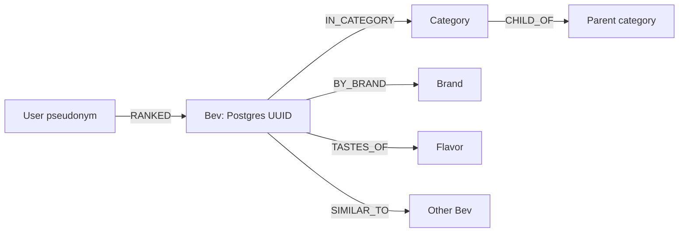

# Beverage icon production plan

Prepared 2026-10-26 against GitHub `main` at `6088bf8`. The root `index.html` is the visual reference and remains unchanged.

Production has begun: see [PROGRESS.md](PROGRESS.md) for authored icons, current coverage, validation and resume instructions.

## Findings and scope

The live Neo4j inspection succeeded at **2026-10-26 21:17 UTC**. There are **0 Bev nodes, 0 relationships, and 1 Meta node**. All six expected uniqueness constraints exist; the two beverage lookup indexes and embedding vector index are online. `Meta.lastSyncAt` is null; `lastKeepAliveAt` is populated. See [graph-inspection.json](graph-inspection.json) for the read-only result summary. This is a configured schema, not a populated beverage graph.

The current repository catalog contains **378 beverages, 145 distinct brand strings, 15 current categories, and 43 starter drinks**. There are 21 `Generic` entries. All 378 have empty UPC, source-image URL, image-license, and attribution fields. Package shape, size, and market are not catalog fields. [catalog-inventory.json](catalog-inventory.json) records every deterministic beverage UUID and these gaps; it is explicitly a repository snapshot, not proof of the live Postgres inventory.

`docs/graph.md` makes Postgres the system of record. Neo4j is the derived relationship store and is never on the app's normal request path. The missing Neo4j sync is a separate backend task; icon creation need not wait for it. To promise coverage of every live beverage, reconcile a live Postgres export with the repository and, once populated, Neo4j. Seed migrations can skip deterministic IDs when an existing live record has the same product identity; user-created records can also exist only in production. Resolve those differences explicitly rather than matching icons by display name.

The intended graph is:

Graph identities are `Bev.id`, `Category.id`, `Brand.key`, `Flavor.name`, `User.pseudonym`, and `Meta.key`. Expected beverage properties include name, brand, flavor, categoryId, priceTier and isAlcoholic; embedding and relationship weights support recommendations, not visual packaging. No actual Bev property population could be observed because there are no Bev nodes.

## Preserve the artwork the user likes

The prototype's seven examples are hand-authored SVG, built from three families: iced cups, standard cans, and bottles. They are substantially richer than the app's current flat `BevArt` placeholders. Use the root prototype as the style master.

- Transparent **200 × 260** canvas; centered upright product; slight top-down view with elliptical openings and rims.
- Soft material gradients, restrained white highlights, translucent glass/plastic, clear liquid/ice/pearls, and a diffuse ground shadow around y=238–240.
- Preserve real package proportions and identifying colors. Warm shading must not turn every product beige or olive.
- Keep UI tilt and decorative backgrounds outside the asset. Retain a single soft ground shadow without stacking extra baked shadows.
- Clean up unused definitions, tiny filler text, and awkward label spacing. Correct silhouettes and labels using real references while keeping the same rendering language.
- Unique gradient/clip IDs per inline instance; no external images, remote fonts, or scripts inside final SVG assets.

[Original-style contact sheet](style-reference/index.html) freezes the seven unchanged examples at master size and app tile sizes. These are **style references, not verified product illustrations**. For example, the prototype shares one bottle shape between Topo Chico and Pure Leaf and uses a generic café badge. Preserve its lighting and detail treatment; verify product shape and branding separately. XML and SVG-ID checks passed; browser/raster visual verification was unavailable in this session.

## Research and identity choices

Research every product before final drawing. Prefer the manufacturer's exact product page and front-facing image, then a reliable retailer if the manufacturer no longer lists it. Open and inspect the image; a search snippet or product title alone is not visual verification. Record the page URL, image URL, access date, market, package format/size, visible identifying features, and any uncertainty. Source photos are research references; their availability does not imply permission to redistribute the photograph.

Default proposal: use a representative US retail package for packaged branded drinks, an actual café serving for café drinks, and an unbranded served beverage for `Generic` records. Keep known historical/discontinued beverages recognizable using dated references; do not silently substitute a different current SKU. Where several package sizes or formulations share a catalog entry, record one representative choice. Resolve identity-changing uncertainty before marking an asset verified.

An initial manufacturer check demonstrates why this matters: OLIPOP has separate [9g-fiber Vintage Cola](https://drinkolipop.com/products/vintage-cola) and [6g-fiber Vintage Cola](https://drinkolipop.com/products/vintage-cola-6g-fiber) listings; the CSV has only `olipop-vintage-cola`. [Spindrift Lemon](https://drinkspindrift.com/products/lemon-sparkling-water) offers both 12oz and 16oz cases. These are research leads, not finalized reference records. Pure Leaf's [manufacturer product page](https://www.pureleaf.com/our-products/?product=Unsweetened+Tea) is another starting point; its image still needs visual inspection.

Do not infer a vessel from category. Coffee includes prepared cups and packaged RTD drinks; spirits/cocktails include generic servings and branded packages. The new taxonomy also has six pending parent-category changes, recorded separately in the inventory. None should change identity or determine an illustration's silhouette.

## Production sequence

1. **Confirm inventory.** Use the 378 catalog rows as the initial worklist. Reconcile live Postgres IDs, status, brand/name/flavor, existing photos and any package clues before claiming production coverage. Include every graph Bev in the reconciliation even if hidden, merged or missing an ID; explain excluded/retired records separately. Use `catalogBevId(slug)` for seed identities and preserve actual live UUIDs.
2. **Establish representative masters.** Research and draw a pilot spanning standard can, slim can, glass bottle, PET bottle, carton, served cup/boba, distinctive small bottle, wine and served cocktail. Compare against the unchanged originals before scaling. Initial candidates: OLIPOP Vintage Cola, Spindrift Lemon, Red Bull Original, Jarritos Mandarin, Fiji, Pure Leaf Unsweetened, Vita Coco Original, Generic Matcha Latte with Boba (`matcha-latte-with-boba`), Tiger Sugar Brown Sugar Boba, Yakult, La Marca Prosecco and Generic Margarita. Packaging choices remain research-dependent; the prototype's café latte is not a verified catalog counterpart.
3. **Freeze shared drawing rules.** One owner maintains materials, silhouettes, light direction, ground shadow, perceived scale and export settings. Recipes provide product-specific body/label colors, proportions, closures, brand layout, flavor motifs and liquid details. Brand families may share geometry only when the real packages do.
4. **Prioritize starters, then expand.** After the family pilot, complete the 43 starter beverages, then the remaining catalog. Assign workers by brand and package family, not arbitrary row ranges. Examples with useful reuse: LaCroix (12), Starbucks (9), Coca-Cola/Jarritos/Zevia/Celsius/Gatorade (8 each), Spindrift/bubly/Monster/Arizona (6 each).
5. **Review every batch together.** Each worker returns its reference records, recipes, SVG masters and contact sheet. A central reviewer checks both reference accuracy and style across families. Flag unresolved records; do not count placeholders as complete.
6. **Integrate once coverage is reconciled.** Keep editable SVG masters and deterministic transparent PNG derivatives for the current native image path. Use a UUID-keyed manifest and one central icon resolver. Test actual native behavior before choosing direct SVG rendering. App adoption and publishing are subsequent implementation work; this planning pass changes neither the app nor DB records.

With the current four-agent limit, use one coordinator/reviewer plus up to three workers. During research they own disjoint brand groups; during drawing they use frozen shared primitives. Workers may propose primitive changes, but the coordinator integrates them so one worker cannot silently change another's output. This is how parallel work remains homogeneous.

## Manifest and files

Use separate files for generated inventory, durable research, editable art, and published assets. Regenerating `catalog-inventory.json` must never erase research or review results.

Each durable icon record should contain:

| Field group | Required information |
|---|---|
| Identity | Actual `bevId`, catalog slug when available, name/brand/flavor, inventory snapshot, identity-conflict notes |
| Appearance | Package family/size/market/version or served form; container, material, liquid, label and distinguishing details |
| Evidence | Reference page/image URLs, inspection date, confidence, uncertainty and historical/variant choices |
| Artwork | Shared primitive/style version, recipe path, SVG path/hash, generated PNG paths |
| Review | Research/drawing/review status, unresolved issues, reviewer, validation result |

Suggested states: `needs-reference`, `needs-identity-resolution`, `ready-to-draw`, `draft`, `needs-review`, `verified`. “Verified” requires visual comparison with references and small-size review; XML validity alone is insufficient.

Keep illustration metadata separate from photo metadata. `BevImage` currently prioritizes `photoUrl`, and the API mapper builds URLs from `bev-photos`. A versioned illustration manifest or separate illustration field avoids replacing real photos or pretending drawings are photos. Default recommendation: retain an existing real product photo; use the product icon where there is no photo, with a deliberate later choice if the design should use illustrations everywhere. Also audit direct photo consumers such as `GutCheck`, not only `BevImage`.

Do not make Neo4j the sole home of icon URLs; metadata must survive graph rebuilds. The app should resolve icons from its catalog/asset layer without Neo4j calls.

## Acceptance criteria

- Every target live beverage UUID has one reviewed icon or an explicitly explained unresolved/excluded record. Catalog count, live count and ready-icon count are reported separately.
- Correct package/serving, brand, flavor and variant; no invented packaging or decorative label claims.
- Consistent lighting, perspective, silhouette scale, baseline, shadow softness and level of detail across a full contact sheet.
- Review at **40, 56, 96 and 155 px square tiles with 8% padding**, including light/dark surfaces. Small type is supplementary; silhouette and color blocking carry recognition at small sizes.
- Validate SVG references, clipping, transparency, render bounds and repeat-instance IDs. Export with pinned renderer/fonts; outline essential lettering or bundle the chosen font rather than relying on system fallbacks.
- Check native image rendering and list performance using representative assets before exporting all 378. The pilot determines output resolution and byte budgets; do not invent a per-icon production estimate before measuring it.

## Reusable tools delivered

- [Skill source](skill/SKILL.md): reusable Bevi beverage-icon workflow for research, consistent drawing, delegation and review.
- [Inventory builder](../../scripts/icons/inventory.ts): `node --experimental-strip-types scripts/icons/inventory.ts`.
- [Read-only graph inspector](../../scripts/icons/inspect-graph.ts): `node --env-file=supabase/.env --experimental-strip-types scripts/icons/inspect-graph.ts --out /tmp/bevi-icon-graph.json`. `--dry-run` prints its fixed queries without connecting. Credentials are never written to reports.

The inspector uses fixed read statements, [read routing](https://neo4j.com/docs/query-api/current/routing/) and [query counters](https://neo4j.com/docs/query-api/current/query-counters/), and checks response errors even on HTTP success. Read routing is not an authorization boundary. No graph writes, keep-alives, schema application, or user-property exports are performed.
