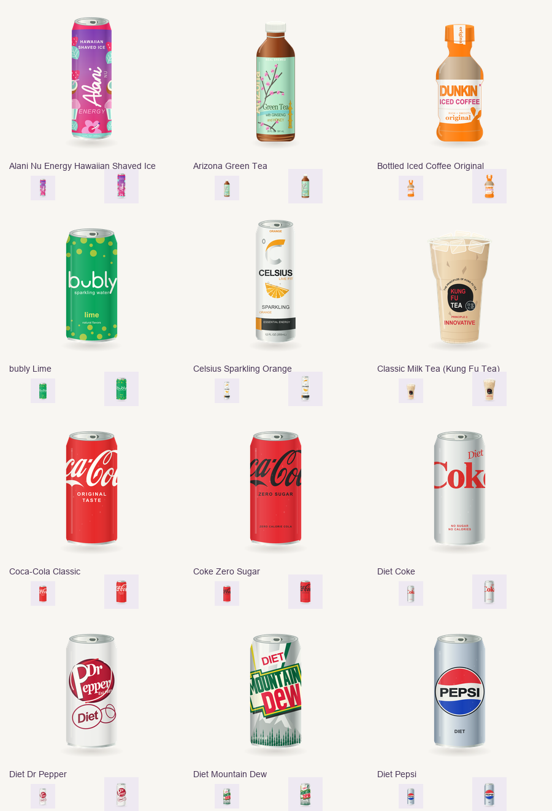

# Bevi beverage icons

Start with the **complete [bevi-beverage-icons SKILL.md](skill/SKILL.md)**. It is the same full skill used to create this collection, included in the repository so another coding agent can follow the identical style and research workflow. No personal skill installation or database credentials are needed to author icons.



[Overview 2](review/overview-02.png) · [Overview 3](review/overview-03.png) · [Overview 4](review/overview-04.png) · [Overview 5](review/overview-05.png)

The current collection contains 49 reference-checked drafts, including 40 of 43 starter drinks. [The manifest](manifest.json) maps catalog UUIDs to editable SVGs, font-independent SVGs and transparent PNGs. [The work queue](coverage.json) lists the 329 remaining catalog drinks, including three explicitly unresolved starter identities. These counts describe the repository catalog; live Postgres reconciliation is still pending. The app shows the icons (see [Ship to the app](#ship-to-the-app)).

## Give this to your coding agent

```text
Read the entire design/beverage-icons/skill/SKILL.md and
design/beverage-icons/PROGRESS.md before generating artwork.
Inspect design/beverage-icons/style-reference/ and the current review sheets.
Use scripts/icons/style.mjs and the existing family recipes as the shared
rendering system. Research and visually inspect real product references.
Choose a disjoint group of remaining starter UUIDs from coverage.json,
add a family module, rebuild, validate, and visually review the batch.
Keep the same canvas, lighting, materials, baseline, scale and detail level.
Record unresolved product variants instead of guessing or marking them verified.
```

The full skill includes product-identity rules, reference requirements, shared drawing constraints, delegation contracts, and visual-review criteria. [PLAN.md](PLAN.md) explains the architecture; [PROGRESS.md](PROGRESS.md) records what exists and where to resume. The original root [index.html](../../index.html) and seven frozen reference SVGs are included as the visual masters.

## Preview without installing anything

Open `design/beverage-icons/index.html` locally in a browser. Search by drink or brand, switch tile sizes, and compare light/dark/transparent backgrounds. Every card links to product evidence and downloadable files. GitHub displays the overview above; download or check out the repository to use the HTML gallery.

## Build and validate

The current authoring/export environment is **macOS, Node 22.6+ and Python 3.9+**. The renderer uses the Arial, Georgia and Times New Roman font files in `/System/Library/Fonts/Supplemental`; exact font hashes are recorded in the manifest. Other systems can use all committed PNGs and outlined SVGs without these fonts, and can run `validate.mjs`; rebuilding editable text requires the documented macOS font setup. Do not silently substitute fonts, which would change the artwork.

From the repository root:

```sh
# Isolated tool dependency; does not modify the app's package files.
npm install --prefix /tmp/bevi-icon-tools --cache /tmp/bevi-icon-npm-cache --no-save @resvg/resvg-js@2.6.2

node --experimental-strip-types scripts/icons/build.mjs
node scripts/icons/validate.mjs

# Optional: regenerate the visual review sheets in an isolated Python environment.
python3 -m venv /tmp/bevi-icon-review
/tmp/bevi-icon-review/bin/python -m pip install Pillow==11.3.0
/tmp/bevi-icon-review/bin/python scripts/icons/review.py
```

If the renderer is installed elsewhere, set `BEVI_RESVG_MODULE` to the absolute path of its `@resvg/resvg-js` package directory. The renderer must remain at 2.6.2.

## Ship to the app

From the repository root, after every batch (and after any redraw):

```sh
node scripts/icons/export-app.mjs          # copy the portable SVGs into the app and regenerate its map
node scripts/icons/export-app.mjs --check  # writes nothing; exits 1 when the app's copy is stale
```

The script reads `manifest.json`, copies each record's `portable-svg/<slug>.svg` byte for byte to `app/public/bev-icons/<slug>.svg`, removes icons no record claims, and writes `app/src/lib/bevIcons.generated.ts` (catalog bevId → `/bev-icons/<slug>.svg?v=<first 8 hex of the SVG's sha256>`, so a redraw busts caches). It fails on a duplicate bevId or slug, a missing source, or a hash that disagrees with the manifest, and a second run changes nothing. Commit `app/public/bev-icons/` and the generated map with the batch; never edit either by hand. In the app a Bev's image is photo > icon > category art: a real photo always wins, and an icon only replaces the placeholder silhouette.

The app's `src/lib/__tests__/bevIcons.test.ts` (part of `npm test -w app`) is the drift guard: it fails when the map or the shipped SVGs no longer match the manifest.

## Add a batch without changing the style

1. Select remaining UUIDs/slugs from `coverage.json`, prioritizing `isStarter`. Tell collaborators which brand/package family you own to avoid duplicate work.
2. Research each exact product. Record the selected package/market, reference page and image URL, inspection date, observed features and uncertainty. Category does not determine package shape.
3. Create a module under `scripts/icons/families/` exporting a `records` array. Follow `pilot.mjs` or `bottles-carton.mjs`; reuse the shared `wrap`, `shadow`, `ref` and `text` helpers from `style.mjs`. Each record includes `slug`, `family`, `packageChoice`, `references`, `uncertainty`, `status` and the full `svg` string. Each reference includes `pageUrl`, `imageUrl`, `inspectedAt`, `observations` and a truthful `visuallyInspected` value. Coordinate changes to shared primitives before altering them.
4. If identity research cannot identify one product, export an `unresolved` array from the family module with `slug`, `status: "needs-identity-resolution"`, `references`, `uncertainty`, and `nextStep`. The build carries this durable research into `coverage.json` without counting it as authored artwork.
5. Rebuild and validate. The build rejects duplicate/unknown slugs and generates assets, the UUID manifest, coverage and gallery. Edit recipes, not generated output. `inventory.ts` rebuilds the separate repository inventory; it does not preserve research entered into that generated inventory file.
6. Inspect the resulting sheets at 40/56/96/155px on light and dark surfaces against the exact reference images. Keep drafts `needs-review` until the relevant review is complete. Update `review/review.json` with the reviewed asset hashes; the renderer does not automatically grant visual approval.
7. Commit the family recipe, generated SVG/PNG assets, manifest, coverage, gallery and review evidence together, plus the app's copy from `node scripts/icons/export-app.mjs` (see [Ship to the app](#ship-to-the-app)). Preserve the original prototype and frozen reference set.

The original prototype is a standalone design reference, not the deployed app. No icon authoring step requires changing Neo4j, Postgres, photos, or app behavior.
