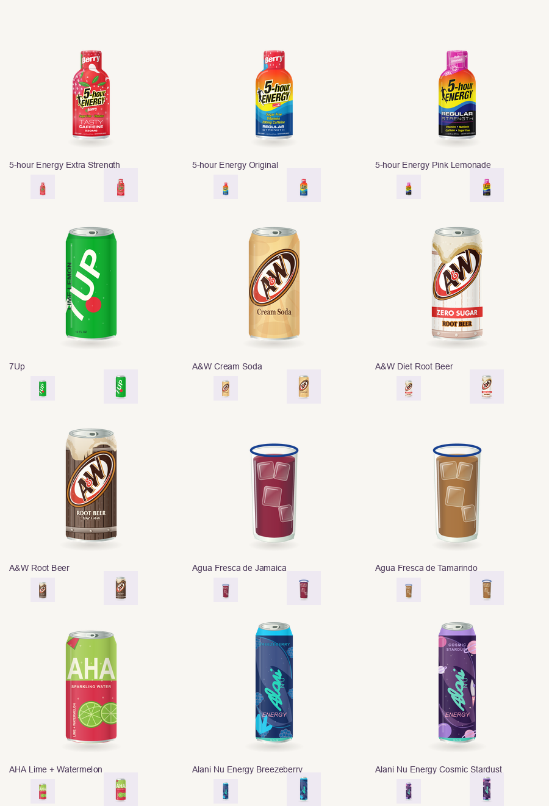

# Bevi beverage icons

Start with the **complete [bevi-beverage-icons SKILL.md](skill/SKILL.md)**. It is the same full skill used to create this collection, included in the repository so another coding agent can follow the identical style and research workflow. No personal skill installation or database credentials are needed to author icons.

Codex discovers this workflow through `.agents/skills/bevi-beverage-icons`, which links to the maintained skill above. Invoke it in this repository with `$bevi-beverage-icons`, for example: “Use $bevi-beverage-icons to create the next 24 beverage icons, prioritizing remaining starters and related brand families.” If a running session does not show the new skill, restart Codex in this repository.



[Overview 2](review/overview-02.png) · [Overview 3](review/overview-03.png) · [Overview 4](review/overview-04.png) · [Overview 5](review/overview-05.png) · [Overview 6](review/overview-06.png) · [Overview 7](review/overview-07.png) · [Overview 8](review/overview-08.png) · [Overview 9](review/overview-09.png)

The current collection contains 335 reference-checked drafts, including 40 starter drinks. [The manifest](manifest.json) maps catalog UUIDs to editable SVGs, font-independent SVGs and transparent PNGs. [The work queue](coverage.json) lists the 43 remaining catalog drinks. These counts describe the repository catalog; the publish job's report reconciles it against the live database (see [Publish to the backend](#publish-to-the-backend)). The app reads the published icons through the backend.

Latest **30-icon batch (2026-11-14)**: [full artwork](review/batch-13-2026-11-14-01.png) · [small-size tiles on light](review/batch-13-2026-11-14-sizes-light.png) · [small-size tiles on dark](review/batch-13-2026-11-14-sizes-dark.png). Added Diet Coke's four documented historical flavors, diet/classic soda cans, RTD coffee, tea, smoothies, wine bottles and a served glass of house Cabernet. Full reference choices and notes are in the recipe module and `review/review.json`.

Previous **30-icon batch (2026-11-14)**: [full artwork](review/batch-12-2026-11-14-01.png) · [small-size tiles on light](review/batch-12-2026-11-14-sizes-light.png) · [small-size tiles on dark](review/batch-12-2026-11-14-sizes-dark.png). Added diet sodas, 5-hour Energy, energy cans, hard seltzers, Mexican lagers and ready-to-drink cocktails. GHOST FaZe Berry and White Claw Lime remain deferred in [identity-issues.json](identity-issues.json).

Latest **4-icon starter recovery**: Tropicana Orange Juice Original, Jamba Mango-a-go-go, Bolthouse Farms Strawberry Banana and Kung Fu Tea Classic Milk Tea. These were drawn in the batch-3 branch that never merged; their recipes were rebuilt on `main` and every asset hash matches the original batch-3 review record. Starbucks Frappuccino Mocha was deliberately left out: the catalog row is `blended_coffee`, so the café-versus-bottled identity stays deferred in [identity-issues.json](identity-issues.json).

Previous **28-icon batch**: [sheet 1](review/large-batch-02-2026-11-02-01.png) · [sheet 2](review/large-batch-02-2026-11-02-02.png) · [sheet 3](review/large-batch-02-2026-11-02-03.png) · [sheet 4](review/large-batch-02-2026-11-02-04.png). Six deferred identities, including the Monster Peachy Keen product-line conflict, are retained in [identity-issues.json](identity-issues.json).

Earlier **29-icon batch**: [sheet 1](review/large-batch-2026-11-02-01.png) · [sheet 2](review/large-batch-2026-11-02-02.png) · [sheet 3](review/large-batch-2026-11-02-03.png) · [sheet 4](review/large-batch-2026-11-02-04.png). Deferred Starbucks/AriZona identities and inspected candidate evidence are retained in [identity-issues.json](identity-issues.json); those rows have no authored icons.

Latest **20 energy icons (2026-11-11)**: [large sheet 1](review/batch-08-large-2026-11-11-01.png) · [large sheet 2](review/batch-08-large-2026-11-11-02.png). All prior artwork retained; final aesthetic approval pending.

Latest **20 classic soda icons (2026-11-11)**: [large sheet 1](review/batch-09-large-2026-11-11-01.png) · [large sheet 2](review/batch-09-large-2026-11-11-02.png). Package-specific bottles and cans; all prior artwork retained.

Latest **20 Fresca, soda and juice icons (2026-11-12)**: [large sheet 1](review/batch-10-large-2026-11-12-01.png) · [large sheet 2](review/batch-10-large-2026-11-12-02.png). Includes both catalog Frescas: Original Grapefruit Citrus and Black Cherry Citrus. All prior artwork retained.

Latest **20 beer and refreshment icons plus Diet 7UP (2026-11-13)**: [large sheet 1](review/batch-11-large-2026-11-12-01.png) · [large sheet 2](review/batch-11-large-2026-11-12-02.png) · [large sheet 3](review/batch-11-large-2026-11-12-03.png). Includes both Hata Kosen Ramune varieties and the current 7UP Zero Sugar can mapped to the Diet 7UP catalog entry. Final aesthetic approval remains pending.

## Give this to your coding agent

```text
Read the entire design/beverage-icons/skill/SKILL.md and
design/beverage-icons/PROGRESS.md before generating artwork.
Inspect design/beverage-icons/style-reference/ and the current review sheets.
Use scripts/icons/style.mjs and the existing family recipes as the shared
rendering system. Research and visually inspect real product references.
Choose a disjoint group of remaining starter UUIDs from coverage.json,
add a family module, rebuild, validate, and visually review the batch.
Keep the same canvas, lighting, materials, baseline, scale and detail level.
Record unresolved product variants instead of guessing or marking them verified.
```

The full skill includes product-identity rules, reference requirements, shared drawing constraints, delegation contracts, and visual-review criteria. [PLAN.md](PLAN.md) explains the architecture; [PROGRESS.md](PROGRESS.md) records what exists and where to resume. The original root [index.html](../../index.html) and seven frozen reference SVGs are included as the visual masters.

## Preview without installing anything

Open `design/beverage-icons/index.html` locally in a browser. Search by drink or brand, switch tile sizes, and compare light/dark/transparent backgrounds. Every card links to product evidence and downloadable files. GitHub displays the overview above; download or check out the repository to use the HTML gallery.

## Sort the icons: Good or Needs work

`npm run icons:swipe`, from the repository root, starts a local server and opens the deck: every icon in `manifest.json`, one card at a time. Swipe right (or press →) for **Good**, left (or ←) for **Needs work**; `Z` undoes. A sorted icon stays in its pile. The terminal prints a second address for a phone on the same Wi-Fi. `-- --local` keeps it to this Mac, `-- --no-open` skips the browser.

- **New icons arrive on their own.** The server re-reads the manifest as it changes, so a build or a `git pull` adds its icons to the deck while the page is open.
- **A redrawn icon comes back.** A verdict records the art it was given to (the first 16 hex digits of the portable SVG's SHA-256). When the art changes, the icon returns to the front of the deck, labelled with the verdict and note it answers.
- **Verdicts are files.** Each person's swipes are written to `verdicts/<name>.json`, one icon per line, so two people never conflict in git. The piles are shared: the newest verdict from either person decides. Commit and push the file to share your sorting; pull to get the other person's.
- **The rework queue** is every `"verdict":"needs-work"` line in `verdicts/*.json`, with the reviewer's note when they left one. The sorted piles in the tool show the same list.

The logic is in `scripts/icons/swipe-core.ts` (tested by `swipe-core.test.ts`), the server in `scripts/icons/swipe.ts`, the page in `scripts/icons/swipe/`.

## Build and validate

The current authoring/export environment is **macOS, Node 22.6+ and Python 3.9+**. The renderer uses the Arial, Georgia and Times New Roman font files in `/System/Library/Fonts/Supplemental`; exact font hashes are recorded in the manifest. Other systems can use all committed PNGs and outlined SVGs without these fonts, and can run `validate.mjs`; rebuilding editable text requires the documented macOS font setup. Do not silently substitute fonts, which would change the artwork.

From the repository root:

```sh
# Isolated tool dependency; does not modify the app's package files.
npm install --prefix /tmp/bevi-icon-tools --cache /tmp/bevi-icon-npm-cache --no-save @resvg/resvg-js@2.6.2

node --experimental-strip-types scripts/icons/build.mjs
node scripts/icons/validate.mjs

# Optional: regenerate the visual review sheets in an isolated Python environment.
python3 -m venv /tmp/bevi-icon-review
/tmp/bevi-icon-review/bin/python -m pip install Pillow==11.3.0
/tmp/bevi-icon-review/bin/python scripts/icons/review.py
```

If the renderer is installed elsewhere, set `BEVI_RESVG_MODULE` to the absolute path of its `@resvg/resvg-js` package directory. The renderer must remain at 2.6.2.

## Publish to the backend

Nothing is copied into `app/`. The app reads each Bev's icon from the backend (`BevSummary.iconUrl`). Each portable SVG is an object in the public `bev-icons` Storage bucket at `<slug>.<first 16 hex of its sha256>.svg`; a redraw is a new object, never an overwrite, so every URL can be cached for a year. `public.bev_icons` links each Bev to its object (`supabase/migrations/20261112000200_bev_icons.sql`), and signed-in users can read a row exactly when they can see the Bev. In the app a Bev's image is photo > icon > category art: a real photo always wins.

After every batch (and after any redraw), build and validate (above), then commit `design/beverage-icons/` and any recipes under `scripts/icons/`. Merging to `main` publishes automatically: the **icons-sync** workflow runs on a push that changes `manifest.json` or `portable-svg/`. To check locally first, with no credentials:

```sh
npm run icons:publish -- --dry-run   # checks every hash and refuses unsafe SVG markup; writes nothing
```

A real run (`npm run icons:publish` with `SUPABASE_URL` and `SUPABASE_SERVICE_ROLE_KEY` exported) is for the workflow, not for authors. icons-sync can also be started by hand; a manual run is a dry run unless `dry_run` is unticked. A real run uploads only objects not yet published, then replaces `bev_icons` with the manifest in one call. Its report reconciles the manifest against the live database: Bevs it names that do not exist there, icons that followed a merge, and how many active Bevs have neither a photo nor an icon.

## Add a batch without changing the style

1. Select remaining UUIDs/slugs from `coverage.json`, prioritizing `isStarter`. Tell collaborators which brand/package family you own to avoid duplicate work.
2. Research each exact product. Record the selected package/market, reference page and image URL, inspection date, observed features and uncertainty. Category does not determine package shape.
3. Create a module under `scripts/icons/families/` exporting a `records` array. Follow `pilot.mjs` or `bottles-carton.mjs`; reuse the shared `wrap`, `shadow`, `ref` and `text` helpers from `style.mjs`. Each record includes `slug`, `family`, `packageChoice`, `references`, `uncertainty`, `status` and the full `svg` string. Each reference includes `pageUrl`, `imageUrl`, `inspectedAt`, `observations` and a truthful `visuallyInspected` value. Coordinate changes to shared primitives before altering them.
4. Rebuild and validate. The build rejects duplicate/unknown slugs and generates assets, the UUID manifest, coverage and gallery. Edit recipes, not generated output. `inventory.ts` rebuilds the separate repository inventory; it does not preserve research entered into that generated inventory file.
5. Inspect the resulting sheets at 40/56/96/155px on light and dark surfaces against the exact reference images. Keep drafts `needs-review` until the relevant review is complete. Update `review/review.json` with the reviewed asset hashes; the renderer does not automatically grant visual approval.
6. Commit the family recipe, generated SVG/PNG assets, manifest, coverage, gallery and review evidence together (see [Publish to the backend](#publish-to-the-backend) for how it ships). Preserve the original prototype and frozen reference set.

The original prototype is a standalone design reference, not the deployed app. No icon authoring step requires changing Neo4j, Postgres, photos, or app behavior.
